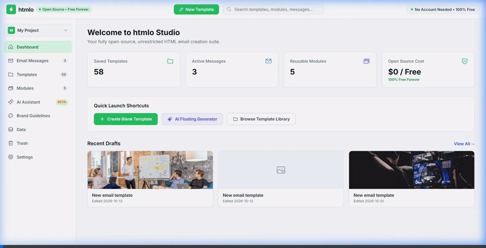
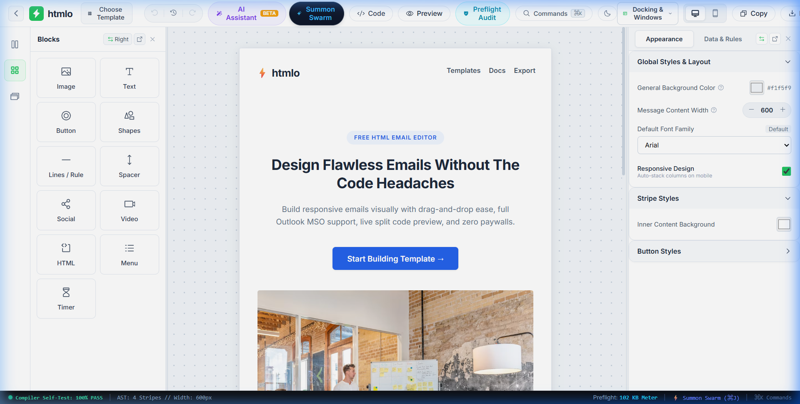
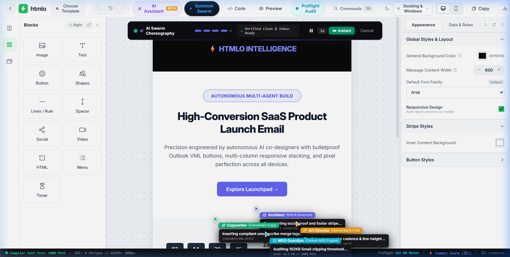
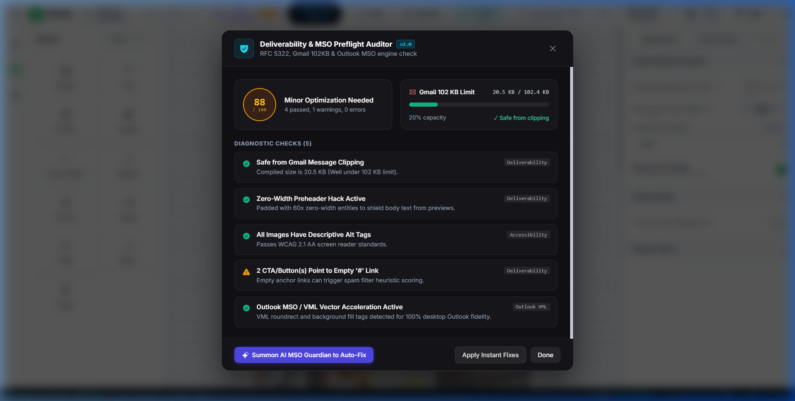

# ⚡ htmlo — Next-Gen WYSIWYG HTML Email Builder & Bulletproof XHTML/MSO Compiler

<div align="center">


<p align="center">
  <b>Enterprise-grade, desktop-class visual email studio and mathematical XHTML/MSO compiler.</b><br/>
  Featuring autonomous collaborative <b>AI Swarm Cursors</b>, 102 KB Gmail clipping meter, VML roundrect buttons, and dynamic floating dock window physics.
</p>

[✨ Live Features](#-key-features) • [🚀 Quickstart](#-quickstart) • [🤖 AI Multi-Agent Swarm](#-autonomous-ai-multi-agent-swarm) • [🛡️ MSO Compiler Engine](#️-bulletproof-mso-compiler-physics) • [📸 Visual Showcase](#-visual-showcase)

---

### 🎥 Live Autonomous AI Swarm in Action


</div>

---

## 📸 Visual Showcase

### 1. Stripo-Class Visual Canvas & Modular Left Dock
*Pixel-perfect email layout canvas with fluid drag-and-drop structures (1, 2, 3, 4 columns), customizable stripes, content width controls, and live property inspector.*



---

### 2. Autonomous Collaborative Multi-Agent AI Swarm
*Four specialized autonomous agents fly across your canvas in real time: Architect, Copywriter, Art Director, and MSO Guardian—generating layouts, streaming copy, and calculating Outlook vector compliance on the fly.*



---

### 3. Deliverability & MSO Preflight Auditor
*Real-time preflight engine monitoring 102 KB Gmail clipping thresholds, Outlook DPI scaling, VML fallbacks, zero-width joiner preheaders, and WCAG AA contrast.*



---

### 4. Dual-Device Real-Time Emulation
*Simultaneous Desktop and Mobile viewport emulation ensuring zero-breakage responsiveness across Apple Mail, Gmail, and mobile Outlook.*


---

### 5. Desktop-Class Command Palette (⌘K)
*Instant keyboard-driven command palette for power users. Insert structures, blocks, run preflight audits, or summon AI swarms with zero latency.*


---

## ✨ Key Features

- **🤖 Autonomous AI Multi-Agent Swarm**:
  - **Architect** *(Indigo)*: Lifts structures, balances column widths, and manages AST hierarchy.
  - **Copywriter** *(Emerald)*: Streams conversion-focused headlines and typography tokens.
  - **Art Director** *(Amber)*: Harmonizes color palettes, button padding, and projects telekinesis laser beams to the inspector.
  - **MSO Guardian** *(Cyan)*: Injects VML vector shapes, conditional Outlook comments, and fixes mobile stacking.
- **🛡️ Bulletproof Email Compiler (`EmailCompiler.ts`)**:
  - Compiles clean AST into 100% compliant XHTML with MSO conditionals: `<!--[if mso]> ... <![endif]-->`.
  - Native `<v:roundrect>` and `<v:fill>` vector buttons for Outlook 2007–2021 / Office 365.
  - Automatic zero-width space (`&zwnj;&nbsp;`) preheader padding to prevent inbox preview leaks.
- **⚡ 102 KB Gmail Clipping Sentinel**:
  - Live byte-meter calculation prevents Gmail from truncating marketing emails.
  - In-memory warning indicators and one-click auto-fix minification.
- **🪟 Physics-Based Floating Windows & Dock Shifting**:
  - Full docking flexibility: Dock Left, Dock Right, or tear off panels into freely draggable floating windows.
  - Persistent layout memory in `localStorage`.
- **⌨️ Keyboard Mastery (⌘K / ⌘J)**:
  - `⌘K` or `Ctrl+K`: Global Command Palette with fuzzy search and quick block drop.
  - `⌘J` or `Ctrl+J`: Instant Summon of the Autonomous AI Swarm.
- **🎨 Pure Vanilla CSS Architecture**:
  - Zero heavy utility CSS frameworks; built with pure CSS tokens, glassmorphic backdrops, and hardware-accelerated transforms.

---

## 🤖 Autonomous AI Multi-Agent Swarm

When you press **Summon Swarm** (`⌘J`), `htmlo` initiates a choreographed 5-phase generation sequence:

```
[Phase 1: Header & Tagline]
 ├─ Architect    ──> Pins 600px Header Stripe
 ├─ Copywriter   ──> Streams Brand Preheader & Tagline
 ├─ Art Director ──> Locks Padding: 24px 32px
 └─ MSO Guardian ──> Sets 96 DPI Fixed Table Layout

[Phase 2: 2-Column Hero & VML CTA]
 ├─ Architect    ──> Drops 50% / 50% Fluid Hero Split
 ├─ Copywriter   ──> Injects Value Proposition Headline
 ├─ Art Director ──> Connects Telekinesis Beam to Inspector
 └─ MSO Guardian ──> Injects <v:roundrect> Bulletproof Button

[Phase 3: 3-Column Feature Grid]
 ├─ Architect    ──> Arranges 33.3% Tri-Column Architecture
 ├─ Copywriter   ──> Drafts Technical Feature Cards
 ├─ Art Director ──> Audits WCAG AAA 7.2:1 Contrast
 └─ MSO Guardian ──> Verifies Reverse Mobile Stacking

[Phase 4: Social Proof & Clean Unsubscribe]
 ├─ Architect    ──> Assembles 4-Network Social Stripe
 ├─ Copywriter   ──> Injects {{unsubscribe_url}} Merge Tag
 ├─ Art Director ──> Calibrates Inter / System Cadence
 └─ MSO Guardian ──> Audits 102 KB Gmail Clipping Budget

[Phase 5: AST Compilation & Completion]
 └─ Fully Compiled, Client-Ready Email Injected into Canvas ✨
```

---

## 🛡️ Bulletproof MSO Compiler Physics

Email clients are notorious for rendering bugs. Outlook uses Microsoft Word's HTML engine (`MSO`), which ignores modern flexbox, CSS grid, and `border-radius`.

`htmlo` solves this with mathematical precision:

```html
<!--[if mso]>
<v:roundrect xmlns:v="urn:schemas-microsoft-com:vml" 
             xmlns:w="urn:schemas-microsoft-com:office:word" 
             href="https://example.com" 
             style="height:44px;v-text-anchor:middle;width:220px;" 
             arcsize="18%" 
             stroke="f" 
             fillcolor="#22c55e">
<w:anchorlock/>
<center style="color:#ffffff;font-family:sans-serif;font-size:15px;font-weight:bold;">
  Claim Offer Now &rarr;
</center>
</v:roundrect>
<![endif]-->
<!--[if !mso]><!-->
<a href="https://example.com" style="display:inline-block;padding:12px 24px;background-color:#22c55e;color:#ffffff;border-radius:8px;text-decoration:none;font-weight:bold;">
  Claim Offer Now &rarr;
</a>
<!--<![endif]-->
```

---

## 🚀 Quickstart

### Prerequisites
- [Node.js](https://nodejs.org/) `>= 18.0.0`
- [npm](https://www.npmjs.com/) or [pnpm](https://pnpm.io/)

### Installation & Local Run

```bash
# 1. Clone the repository
git clone https://github.com/rishabhchobey95-sketch/htmlo.git

# 2. Enter directory
cd htmlo

# 3. Install dependencies
npm install

# 4. Start local development server
npm run dev
```

Visit `http://localhost:5173/` in your browser.

### Quality Validation

```bash
# Run lightning-fast Oxlint checks (0 warnings, 0 errors)
npm run lint

# Build production bundle with TypeScript strictness
npm run build
```

---

## 📂 Project Architecture

```
htmlo/
├── media/                       # 📸 High-res screenshots, demo MP4, and animated GIF
│   ├── ai_swarm_demo.gif
│   ├── ai_swarm_demo.mp4
│   ├── ai_swarm_live.png
│   ├── audit_panel.png
│   ├── command_palette.png
│   ├── editor_overview.png
│   └── preview_modal.png
├── src/
│   ├── compiler/                # 🛡️ Bulletproof XHTML & MSO Compiler Engine
│   │   ├── EmailCompiler.ts
│   │   └── compilerTest.ts
│   ├── components/              # 🎨 UI & Interactive Components
│   │   ├── AiFloatingCursors.tsx # 🤖 4-Agent Spatial Cursor Choreography
│   │   ├── AiAssistantModal.tsx  # ✨ Natural Language Prompt Assistant
│   │   ├── AuditPanel.tsx        # 🔍 102KB Gmail & MSO Preflight Auditor
│   │   ├── Canvas.tsx            # 📐 Visual Drag-and-Drop Canvas
│   │   ├── CommandPalette.tsx    # ⌨️ Cmd+K Keyboard HUD
│   │   ├── LeftDock.tsx          # 📦 Blocks & Structures Drawer
│   │   ├── InspectorPanel.tsx    # 🎛️ Real-time CSS & Attribute Controls
│   │   ├── PreviewModal.tsx      # 📱 Dual Mobile/Desktop Emulation
│   │   ├── TopBar.tsx            # ⚡ Main Action Bar & Triggers
│   │   └── reactbits/            # ✨ Motion & Aesthetic Primitives
│   │       ├── AnimatedBeam.tsx  # ⚡ Dynamic Vector Telekinesis Laser
│   │       ├── DecryptedText.tsx # 📟 Token Decryption Scrambler
│   │       ├── ShinyText.tsx     # 🌟 Shimmer Text Sweep
│   │       └── StarBorder.tsx    # 💫 Rotating Conic Gradient Frame
│   ├── types/                   # 📐 Strict TypeScript AST Definitions
│   │   ├── editor.ts
│   │   └── dock.ts
│   ├── App.tsx                  # 🏛️ Root Application & Layout Orchestrator
│   ├── main.tsx                 # 🚀 React 19 Entrypoint
│   └── index.css                # 💎 Vanilla Design System Tokens & Animations
├── package.json
├── tsconfig.json
└── vite.config.ts
```

---

## 📄 License

Distributed under the **MIT License**. See `LICENSE` for more information.

---

<div align="center">
  <sub>Crafted with passion for bulletproof email engineering.</sub>
</div>
